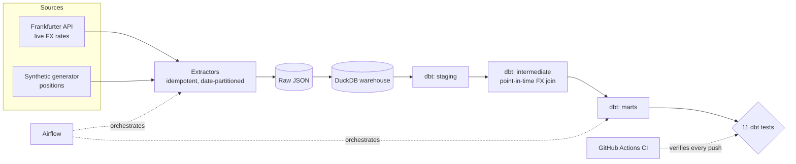

# fx-reporting-pipeline

An ELT pipeline that turns raw FX rates and position data into audit-ready, EUR-denominated
reporting marts — built the way a finance-reporting data team actually would: layered
transformations, data-quality tests that gate publication, orchestration with retries, and
CI that proves the pipeline still works on every change, not just on one developer's machine.

A wrong number in a financial report is worse than a crash — nothing tells you it happened.
Every design decision here optimizes for that: the pipeline refuses to publish data that
fails its own tests, and every claim in this README is backed by something that was actually
run and verified, not assumed.

## Architecture



## Status

**Built and verified — every item below was actually run, not just written:**

| Component | Proof |
|---|---|
| Extractors (FX rates + synthetic positions) | Idempotent, unit-tested, live API confirmed |
| DuckDB warehouse | Loaded and queried from raw JSON |
| dbt (staging → intermediate → marts) | 5 models, point-in-time FX join, 11 passing data-quality tests |
| Defect-injection evaluation | 4 real defects injected, tests caught them — [see below](#data-quality-defect-injection-evaluation) |
| Airflow (Docker, `LocalExecutor`) | Full DAG run reached `success` end-to-end in Airflow's own task history |
| CI (GitHub Actions) | Verified locally with `act` before ever pushing — passes for real |
| pytest unit tests | 8 tests, mocked HTTP, wired into CI |

**Designed and code-complete, not yet executed:**
- NL→SQL LLM assistant (`llm_assistant/`) — schema-grounded prompt, `sqlglot`-based SQL
  validation, a read-only DB connection as a second safety layer, one repair loop on failure.
  The validation layer *is* fully tested (5 cases, zero LLM calls needed); the actual model
  calls are implemented but not run, since that costs real API credit — a deliberate scoping
  choice while finalizing, not a limitation. See `docs/system-design.md` ADR-014.

**Not started yet:** Snowflake port, Streamlit dashboard.

Every decision behind these choices — including the ones still ahead — is logged with
context and consequences in [`docs/system-design.md`](docs/system-design.md).

## How to run

**Manually:**
```bash
./venv/Scripts/python.exe extractors/fx_rates.py
./venv/Scripts/python.exe extractors/positions.py
./venv/Scripts/python.exe warehouse/load_raw.py
cd dbt_project
../venv/Scripts/dbt.exe run --profiles-dir .
../venv/Scripts/dbt.exe test --profiles-dir .
```

**Orchestrated (Airflow, via Docker):**
```bash
cd airflow_docker
docker compose up airflow-init   # first time only
docker compose up -d
# webserver at http://localhost:8081 (user: airflow / pass: airflow, local dev only)
```

**Tests:**
```bash
./venv/Scripts/python.exe -m pytest tests/ -v
```

## Data quality: defect-injection evaluation

To prove the dbt tests actually catch bad data — not just pass trivially —
`tests/defect_injection_eval.py` injects 5 realistic defects into the raw layer, then runs
the full model + test suite against the corrupted data.

| # | Defect | Caught by | Result |
|---|--------|-----------|--------|
| 1 | Null FX rate | `not_null` on `stg_fx_rates.rate` | Caught (1 row) |
| 2 | Duplicate position key | `unique` on `stg_positions.position_id` / `fct_position_valuation.position_id` | Caught (both layers) |
| 3 | Out-of-range value (negative amount) | `assert_positive_eur_value` (singular test) | **Not caught** in this run — see finding below |
| 4 | Stale date (no fresh data for N days) | *not covered yet* | Planned: dbt source freshness + Airflow SLA |
| 5 | Orphan position (no matching FX rate for its date) | `not_null` on `fct_position_valuation.eur_value` | Caught (4 rows — the orphan plus 3 positions also hit by defect 1) |

**Finding worth calling out:** defect 3 landed on a USD position on the same date as defect 1
(the null rate). `eur_value = -50000 / NULL = NULL`, and `NULL <= 0` evaluates to unknown in
SQL — not true — so the singular test's `WHERE eur_value <= 0` filter didn't match that row.
Two defects on the same row masked each other. The `not_null` test on `eur_value` still
caught the row (for the null-rate reason), but it's a real reminder that overlapping defects
can create blind spots even in a passing-looking test suite — coverage isn't just "does a
test exist," it's "does it still fire when combined with everything else that can go wrong."

```bash
python tests/defect_injection_eval.py                          # inject
cd dbt_project && dbt run --profiles-dir . && dbt test --profiles-dir .   # observe failures
python warehouse/load_raw.py                                    # reset (raw is always
                                                                  # rebuilt from source JSON)
```

## Project layout

- `extractors/` — idempotent Python extractors: live FX rates (Frankfurter API), synthetic
  positions (deterministic, seeded by date).
- `warehouse/` — loads raw JSON into DuckDB (`load_raw.py`) and holds the database file.
- `dbt_project/` — staging → intermediate (point-in-time FX join) → marts, plus data-quality
  tests (`models/*/_*.yml`, `tests/`).
- `dags/`, `airflow_docker/` — Airflow DAG and its Docker Compose runtime.
- `.github/workflows/` — CI, verified locally with `act` before every push.
- `llm_assistant/` — NL→SQL assistant: schema grounding, SQL validation, read-only execution.
- `tests/` — Python-level tests, including the defect-injection evaluation.
- `docs/` — [`system-design.md`](docs/system-design.md) (every architecture decision, why,
  and its consequences — ADR format), [`learning-log.md`](docs/learning-log.md) (concepts and
  real bugs found, task by task), [`runbook.md`](docs/runbook.md) (operational reference),
  [`mastery-plan.md`](docs/mastery-plan.md) (structured plan to rebuild this independently).
